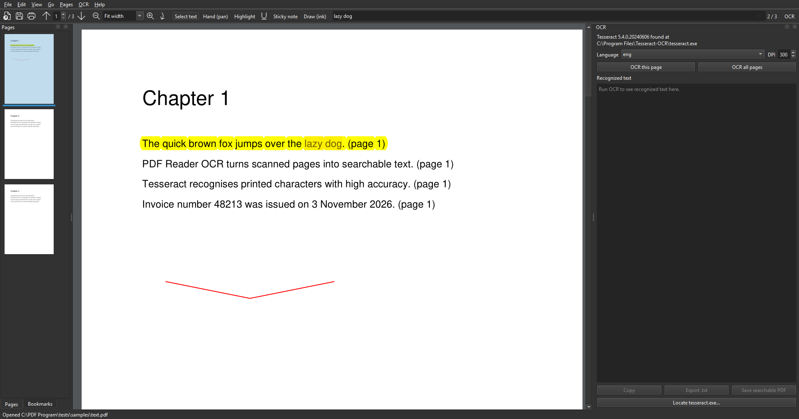

# PDF Reader OCR

A free, open-source PDF reader for Windows with built-in OCR.
Open scanned PDFs, recognise the text with [Tesseract](https://github.com/tesseract-ocr/tesseract),
and save a searchable copy, all from one lightweight app that registers itself
as a handler for `.pdf` files.



## Features

- **Viewer**: continuous scrolling, zoom (fit width / fit page / custom), rotate,
  page thumbnails, bookmarks/outline, full-text search with highlighting, print,
  password-protected files, drag-and-drop, recent files, dark mode.
- **OCR** (Tesseract 5, English pack bundled):
  - run on the current page or the whole document, with a cancellable progress bar
  - recognised text in a side panel with a copy button
  - **Save searchable PDF**: writes an invisible text layer over the scanned
    pages so text can be selected and searched in any PDF reader
  - **Export .txt**
  - extra languages: drop more `*.traineddata` files into
    `<install dir>\tesseract\tessdata` (or point the app at your own Tesseract)
- **Annotations**: highlight, underline, sticky notes, freehand ink; delete via
  right-click; saved back into the PDF.
- **Page tools**: organize (reorder, rotate, delete, extract, insert), merge
  several PDFs, split a PDF into parts.
- **Windows integration**: the installer registers the app for `.pdf` files
  (Open With, Default Apps) and adds Start Menu entries. Windows requires you
  to confirm the default app yourself; the installer and *Help > Set as default
  PDF viewer* open the right Settings page.

## Install

Download `PDFReaderOCR-Setup-<version>.exe` from the
[Releases](https://github.com/zimba7768/pdf-reader-ocr/releases) page and run it.
No other downloads are needed; Tesseract is bundled.

The app is unsigned, so Windows SmartScreen may show a warning on first run
("More info" > "Run anyway").

## Run from source

```bash
git clone https://github.com/zimba7768/pdf-reader-ocr.git
cd pdf-reader-ocr
python -m venv .venv
.venv\Scripts\pip install -e .[test]
.venv\Scripts\python -m pdf_reader_ocr [file.pdf]
```

OCR needs Tesseract on the machine when running from source. The app looks in
`Program Files\Tesseract-OCR`, `%LOCALAPPDATA%\Programs\Tesseract-OCR`, on
`PATH`, or you can pick `tesseract.exe` from the OCR panel.
Install with `winget install UB-Mannheim.TesseractOCR`.

### Tests

```bash
.venv\Scripts\python -m pytest tests -q
.venv\Scripts\python tests\smoke_gui.py   # offscreen GUI smoke test, writes screenshots to tests/_shots
```

## Build the installer

Requires Tesseract (see above) and [Inno Setup 6](https://jrsoftware.org/isinfo.php).

```powershell
.venv\Scripts\pip install -e .[build]
powershell -ExecutionPolicy Bypass -File packaging\build.ps1
```

The script runs PyInstaller (`packaging/pdf_reader_ocr.spec`), copies a trimmed
Tesseract into `dist\PDFReaderOCR\tesseract`, and compiles
`packaging/installer.iss` into `installer_output\`.

### Releases

Pushing a tag such as `v0.1.0` triggers the GitHub Actions workflow in
`.github/workflows/release.yml`, which builds the installer on a Windows runner
and attaches it to a GitHub Release. Bump `__version__` in
`src/pdf_reader_ocr/__init__.py` first.

## How the OCR text layer works

Each page is rendered at the chosen DPI (300 by default), sent to Tesseract in
TSV mode, and every recognised word comes back with a bounding box. Those boxes
are converted to PDF coordinates and written with PyMuPDF as invisible text
(render mode 3) sized to span the box, so search highlights and selections
line up with the printed glyphs. The original page image is left untouched.

## License

The application code is MIT licensed. The installer bundles PyMuPDF (AGPL-3.0),
Tesseract (Apache-2.0), Leptonica (BSD) and Qt/PySide6 (LGPL-3.0), which keep
their own licenses; see [LICENSE](LICENSE).
